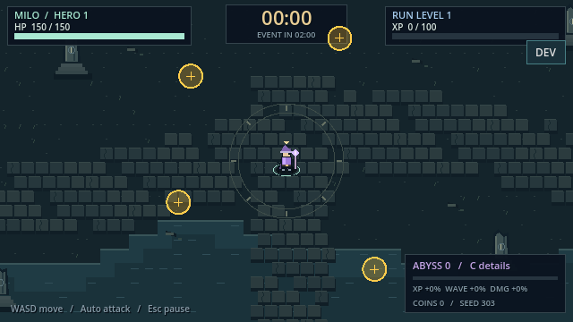

# Phase 7 实施 — 2026-10-20

**状态：4项修复完成并验证，整体验收部分完成。** T065/T066/T074/T075已勾；T067–T073及原7项人工/自然验收继续开放。共75项，61勾选、14未勾选；这不是完成率或全面验收结论。

## 改动与使用

- 恢复固定Godot4.5元数据，移除本2D项目不使用的新3D兼容项；[改动前配置](project-before.godot.txt)保留。没有改伤害/XP/波次/操作/存档字段或新增依赖。
- 最终快照新增生成预留/序号/首领标志、待伤害与预警判定几何、救援/腐化时钟、待奖励/注册表、弹体职业等状态，标识`pacing-final-v2`。每个遗漏字段的独立突变会报告差异；JSON写入及比较使用完整精度。旧录制的fixture hash不兼容时须完整重录，不硬改hash。
- 会话先终结预警，再从最终trace统计计数。提前退出、预警中死亡、watchdog和重复终结有回归；终局同步保存的完整快照保留，避免deferred清理改变观察。
- 性能工具补目标机/真实端点守卫，比较两轮CPU/GPU、engine/renderer/simulation/catalog/build/fixture、driver/device/sample rate和每轮负载/奖励守恒。`-Diagnostic`只允许Benchmark；非目标机诊断不能宣称SC007达标。记录逐帧focus、约1秒可见进程CPU/内存和10秒电源方案。

当前Release：[AbyssExpedition.exe](../../../../builds/windows/combat-pacing-audio/phase7-release-20261020/AbyssExpedition.exe)。Debug导出也保留于该目录；双击根目录`Play Debug.cmd`继续运行固定4.5的当前源码。WASD/方向键移动、自动攻击；1/2/3升级、Esc暂停、C腐化说明，DEV/F9仅开发版。

## 实际验证

| 检查 | 执行结果与证据 |
| --- | --- |
| 新增回归red | [pacing](red-pacing/pacing.log)4个预期行为失败；[unit](red-benchmark/unit.log)3个目标/设备拒绝失败。解析通过，没有用装载失败冒充red。 |
| 成对性能守卫 | [旧规则red](red-pair-behavior.log)接受错误目标；[green](green-pair-contract.log)19个构造检查通过。最初缺文件日志另保留，不算行为red；构造数据不是性能样本。 |
| 窄测 | unit306通过；[green-focused-v3](green-focused-v3/) pacing326、replay58、强制debug_panel126，0失败/跳过；未知suite/非法seed按预期拒绝。 |
| 完整M4 | [regression](regression/)16组9,232原生断言，0失败/跳过。import/parse/content通过：52根Resources、27场景、116脚本。三初始角色自动全程胜利是受控模拟，不是自然试玩。 |
| 图形/实际导出 | 源码M1–M4三尺寸受控图形通过，音频/focus15、源码DEV118、[实际Debug DEV118](regression/debug-exported-graphical.log)、[实际Release拒绝41](regression/debug-release-denial.log)均通过；实际Release M4图形通过。 |
| 真实输出 | [WASAPI原始录音](audio/loopback-raw.wav)35.005秒，48kHz/float32/立体声，设备/系统音量约63%在[audio/loopback.json](audio/loopback.json)；8声部、检测削波0、非有限样本0。三职业/负例事件日志无失败，未归一化。回环可包含其他应用；逐段试听与盲听未执行。 |
| 当前构建完整性 | [build-integrity](build-integrity.json)：源码、新Release、真实录音、性能及各fixture/exe hash匹配。旧构建和失败日志保留。 |
| 离线文档 | 见[docs-check](docs-check.json)：实际扫描范围、断链/alt/远程资源、冻结音样与任务/只读清单状态。未宣称浏览器响应式人工验收。 |

中间失败保留于green-focused及green-focused-v2：快照测试对数组元素路径及JSON数值类型用了过严的Variant断言，随后改为定位子路径和逐字段语义差异；完整精度输出另同步修复。最终上述checks均实际通过。



## 本机性能样本

Ryzen7 5800H / GTX1650，固定4.5真实Release、1920×1080、VSync off、无调试器、seed101、真实WASAPI / Default / 48000Hz。各30主动秒预热+120主动秒采样；100常规+1首领、双同伴、≥30效果、≥100活动弹体、500宝石、腐化100及奖励守恒均有效，两轮kills382。

| 音频 | 帧样本 | p50 ms | p95 ms | p99 ms | max ms | cues / 峰值声部 |
| --- | ---: | ---: | ---: | ---: | ---: | ---: |
| 开启 | 10916 | 12.320 | 15.172 | 19.647 | 76.035 | 861 / 6 |
| 关闭 | 11106 | 12.337 | 15.063 | 17.722 | 26.066 | 0 / 0 |

[原始CSV/JSON](performance/)及[比较结果](performance/comparison.json)：本机开启样本满足p95≤16.67ms/p99≤25ms，保留max76.035ms尖峰，不以一对样本推断音频因果开销。

两轮每帧focus观察均0次失焦；各150条约1秒进程采样，10秒电源方案及首尾Balanced一致。但Get-Process执行范围仅暴露游戏/控制台辅助进程，不能证明全主机后台CPU/GPU负载。**T073保持部分完成，不勾选**；[环境范围复核](environment-review.json)明确此限制。comparison中的`environment_observed`/`sc007_sample_pass`只表示可用采样器与本机样本门槛，`human_or_reference_acceptance=false`；不能据此关闭T073、完整SC007、历史参考机或多seed gate。

## 实际命令

```powershell
python .specify/scripts/python/check_prerequisites.py --json --require-tasks --include-tasks
./tools/run_validation.ps1 -OnlySuites @('pacing') -DummyAudio -EvidenceDirectory docs/validation/combat-pacing-audio/phase7-20261020/red-pacing
./tools/run_validation.ps1 -OnlySuites @('unit') -DummyAudio -EvidenceDirectory docs/validation/combat-pacing-audio/phase7-20261020/red-benchmark
./tools/test_pacing_benchmark.ps1
./tools/run_validation.ps1 -OnlySuites @('pacing','replay') -DummyAudio -EvidenceDirectory docs/validation/combat-pacing-audio/phase7-20261020/green-focused-v3
./tools/run_validation.ps1 -M4 -Graphical -Export -DummyAudio -BuildDirectory builds/windows/combat-pacing-audio/phase7-release-20261020 -EvidenceDirectory docs/validation/combat-pacing-audio/phase7-20261020/regression
./tools/validate_pacing_audio.ps1 -Mode Audio -EvidenceDirectory docs/validation/combat-pacing-audio/phase7-20261020/audio
./tools/validate_pacing_audio.ps1 -Mode Benchmark -ReleaseExecutable 'C:/Users/kahhe/Desktop/Project/new-game-project/builds/windows/combat-pacing-audio/phase7-release-20261020/AbyssExpedition.console.exe' -EvidenceDirectory docs/validation/combat-pacing-audio/phase7-20261020/performance
```

Dummy只用于逻辑/受控图形；录音与性能命令使用真实设备。PowerShell语法已实际解析检查。已目视本轮seed303近场预警和升级界面DEV截图，四预警/DEV可见；这不是自然试玩或物理操作。源码/工具/配置10个变更文件的hash见[implementation-files](implementation-files.json)。

## 仍需的真实验证

| 任务 | 状态与继续方式 |
| --- | --- |
| T067；旧T018/T032 | US1与Integrated各完整自然九局，无真人移动记录；按quickstart使用Record全新目录，保留失败及固定三职业×三seed。未生成替代轨迹。 |
| T068；旧T052 | 依赖上述冻结集成九局，之后Replay实际执行音频开/关9对；已有受控复放/边界暂停通过，不替代自然会话。 |
| T069；旧T053 | 本轮真实录音已完成，逐段人工试听仍未执行；关键升级可听、受伤优先/同伴较轻及残音听感继续开放。 |
| T070/T071；旧T059/T060 | 真实新玩家理解/盲听回答0/5。原100个刺激及当前音样hash一致，可继续用冻结离线页；无代填答案。 |
| T072；旧T061 | 物理鼠标/键盘28动作、跨屏/暂停/重开及隔离档人工烟测未执行。 |
| T073 | 新Release性能样本及focus/电源记录完成；全主机后台负载仍未验证，需在可观察完整环境下补验。 |

requirements清单16/16、pacing-audio评审0/38，只读未代勾；沿用会话授权继续，无例行审批。Git仓库/现有.gitignore已核对，Godot缓存/构建/运行档/Python与通用临时文件规则齐备，没有Docker/Node/Terraform等需要额外ignore的技术。实施前后均未发现`.specify/extensions.yml`，无前/后implement hooks。

[任务](../../../../specs/002-combat-pacing-audio/tasks.md) · [验收矩阵](../acceptance.md) · [开发图鉴](../../../game-development-dashboard.html) · [实现概览](../../../IMPLEMENTATION_OVERVIEW.md) · [原收敛核查](../convergence-20261020/results.md)
