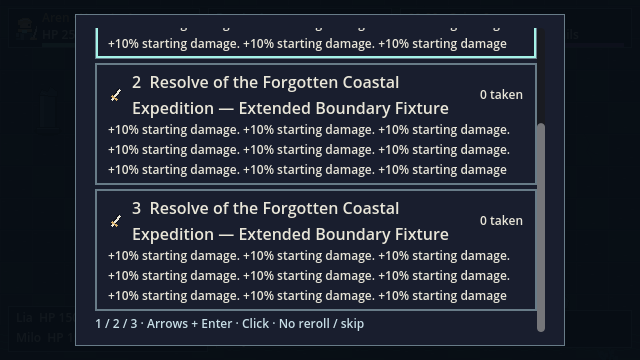
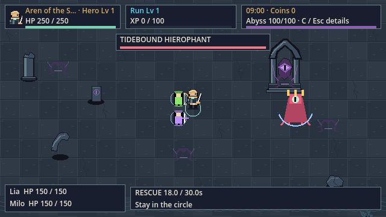

# VD-01-P2 · 当前切片收尾

2026-10-17 · Owner已回复 **“verified proceed the rest”**，并明确只完成当前八件切片的剩余工作。[实际反馈/范围](owner-verification-2026-10-17.json)。已验证的f187版本与嵌入EXE完整保留在[归档](owner-verified-f187/evidence/candidate-files.json)，不把反馈换算成十人答案或硬件测量。

**文本修复、原生检查与两组完整性能测量已完成；自动回归通过，性能仍未达预算。** 当前版本VD-01-P2，候选 `bbab5acb8f5e62ace5784d025ad1841c50b4cc08158f0bb9899720635d4339e3`，发布包 `38ea36e5dfbc702510228a940bbd0d3feb60f920db527d2aac56a6263791c2e0`。[逐文件版本](completion-r1/candidate-files.json)确认生产文件只改HUD、ChoiceCard、暂停页三个显示脚本。角色/场景/动画/战斗/数值/AI/成长/保存规则未变，未扩展G3。

## 可以直接查看

[离线预览](../../visual-design/preview.html) · [当前实机对照](../../visual-design/runtime-gallery.html) · **[真实时钟动作播放器](../../visual-design/wallclock-gallery.html)** · [试玩EXE](../../../builds/windows/m4/AbyssExpedition.exe)。公会→Expedition→基础Aren；WASD走位，自动攻击，1/2/3升级，Esc暂停。





## 已执行并验证

| 项目 | 实际结果 |
| --- | --- |
| 长文本修复 | 名称省略不隐藏准确Hero Lv；暂停页保留全名；升级标题完整换行。旧版12个失败已留档；新版源码/发布各54项、0失败。目录文字/效果未被测试修改 |
| 原生功能回归 | 12组5,278＋debug69＝**5,347**条断言；0失败/跳过。源码与发布图形、M2/M3/M4实际EXE、F9源码/开发导出及发布禁用通过 |
| 玩法对照 | 保留旧EXE与当前EXE：seed101、120tick观测一致；内容校验与版本保护保留 |
| 当前视口矩阵 | 源码/发布各287张：三尺寸、腐化0/100、boss/双同伴/救援状态、八个边角、程序回退、两种特效的新版/晋升回退 |
| 真实时钟片段 | 源码163帧/19段，当前发布134帧/17段，原版137帧/17段。自然运行的四向动作与暂停；受击/中断/迟到/死亡观察者状态注入另有明确标记；普通死亡敌人由原模拟清理 |
| 长保存路径/提示 | 源码/发布各24个只读显示样本；四种保存错误状态保留完整路径；三尺寸×四角提示均观察到，原生引擎定位在视口内。不执行保存、Retry或恢复 |

HUD全部可见Control并集及边角定位按当前记录复核；基础布局与已验证父版本一致。当前普通构图与父版本[逐像素比较](completion-r1/verified-parent-image-comparison.json)，测试不把缩略图或生成黑边板当作实机窗口截图。

最大并集仍为56,712/230,400＝24.61%；八个边角的脚锚均在HUD矩形外。[当前HUD测量](completion-r1/hud-acceptance.json) · [八边角原图联系表](completion-r1/edges-contact.png)（DERIVED排版，内含未重绘的真实视口）。源码捕获含既有F9开发提示，发布版没有该覆盖；它不计入正式战斗HUD面积。原生文字几何检查不是逐像素字形/外部覆盖层的全面裁切证明。

[回归计数](completion-r1/regression-summary.json) · [原生文本检查](completion-r1/text-summary.json) · [源码原始记录](../../../screenshots/visual-vd01/completion-r1/source-r2/capture-manifest.json) · [发布记录](../../../screenshots/visual-vd01/completion-r1/release-r2/capture-manifest.json) · [真实时钟记录](completion-r1/wallclock-summary.json) · [玩法对照](completion-r1/gameplay/comparison.json) · [辅助UI源码](completion-r1/aux-source/manifest.json) · [辅助UI发布](completion-r1/aux-release/manifest.json)。108/574/48是观察样本，未重复加入5,347条功能断言。

## 窗口与验收限制

实测引擎窗口变换：1280×720为2×、1920×1080为3×；1371×779为2×，黑边按**左46/上30/右45/下29**分配。[原始窗口变换](completion-r1/window-transforms.json)。早期提案把奇数余量放在另一侧；当前记录来自运行引擎，保持整数像素。它仍不是带系统边框的物理窗口截图，不能据此宣布显示抖动或延迟通过。

参考机性能、物理输入/显示延迟、十人识别/UI原始答卷和完整自然操作会话仍未完成。Owner已验证的视觉反馈单独记录；没有伪造参与者、测量方法或整体G2通过。其余屏幕10/11px历史文字仍属G3设计范围，本轮只检查并保留原行为。

T046/T068/T075/T076的原生布局/外观检查已完成；任务表现为77/87。剩余10项保留物理窗口/显示、完整自然操作/字形审阅、性能/参考机、十人答卷及正式reviewer清单的未满足部分。按[$speckit-implement](../../../.agents/skills/speckit-implement/SKILL.md)的 **“do NOT modify checklist files or markers”**，reviewer清单文件保持只读；实际执行与owner反馈写入本报告和审批记录。没有把实施许可变成评审勾选。

Windows曾阻止验证工具覆盖被映射的公共脚本；失败日志保存在`completion-r1/release-regression/`。工具现按EvidenceDirectory独立存放harness，`release-regression-r2/`完整复验通过。没有终止用户编辑器或放弃错误。

## 性能

[本轮完整报告](completion-r1/performance.md) · [逐seed/当前包校验](completion-r1/performance-summary.json) · [此前原版/父版本数据](performance.md)。六次采样均有效：每seed30主动秒预热＋120主动秒测量，Compatibility1920×1080、VSync0、无帧率上限。

| 负载 | seed101 p95 / p99 | seed202 p95 / p99 | seed303 p95 / p99 |
| --- | --- | --- | --- |
| 原M4 | 28.018 / 29.357 | 28.257 / 29.302 | 28.442 / 29.650 |
| P02新版动效 | 17.955 / 23.699 | 17.744 / 18.513 | 17.965 / 18.838 |

单位ms；每seed必须同时p95≤16.67、p99≤25，**六组均未通过预算**。P02实际新版剑弧≥30、基础友方星≥100、新版角色≥1，其他原M4目标与真实寿命保留；before/current fixture哈希一致。两种负载独立，不合并数字，也不把采样变化归因于文本修复。本机Ryzen7 5800H/GTX1650并非参考机；RAM查询不可用，功耗/前台状态未独立确认。参考机和物理延迟验收仍未完成。

可复现命令（使用新的EvidenceDirectory避免覆盖）：

```powershell
./tools/run_m4_benchmarks.ps1 -Release -EvidenceDirectory docs/validation/visual-vd01/completion-r1/perf-new
./tools/run_visual_stress.ps1 -Mode after -Executable C:/Users/kahhe/Desktop/Project/new-game-project/builds/windows/m4/AbyssExpedition.console.exe -EvidenceDirectory docs/validation/visual-vd01/completion-r1/perf-visual-new
```

[剩余10项与具体原因](completion-r1/remaining-tasks.json)。继续生产美术或重构玩法不属于本次授权；本批未进一步扩展。
