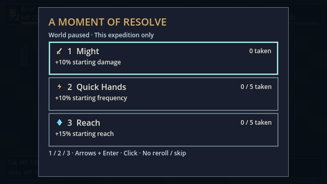
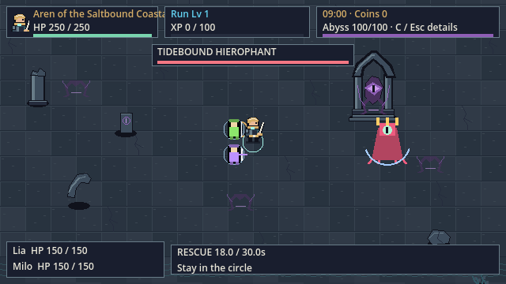
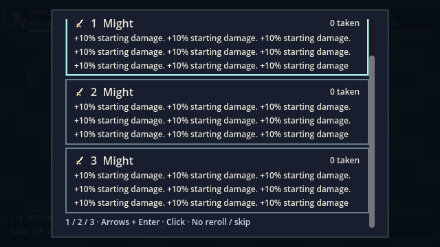
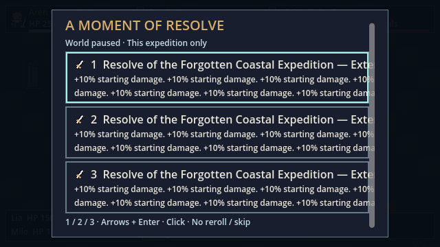

# 原生 UI 边界复核 · 2026-10-17

**父版本历史记录。** 两项合成长名称/标题限制已在[VD-01-P2](completion-r1.md)修复并完成源码/发布复验；本页保留原失败证据，不代表当前包仍有相同问题。

**当前内容检查通过；合成压力样本有两项限制。** 本轮只增加外部检查及文档，未改生产脚本、场景、素材或试玩 EXE。候选仍为 `f187bd763fe92b69069722432c4534178c32206be6cf76a59ba9fe8fe7e95d42`；[逐文件/发布包哈希复核](ui-boundary/summary.json)确认冻结版本未变。G2继续待审。

| 实际执行 | 源码 | Windows 发布版 |
| --- | --- | --- |
| 观测记录 | 51 | 51 |
| 当前内容：六种英雄HUD名称、十二种升级 | 30 | 30 |
| 合成压力样本 | 21 | 21 |
| 当前内容缺失字形、模态面板出界、横向内容宽度检查失败 | 0 | 0 |
| 夹具前后目录名称/效果校验 | 一致 | 一致 |

三个请求窗口：1280×720、1920×1080、1371×779；截图均为真正的640×360 Godot视口，**没有物理窗口黑边**。英雄身份替换仅用于HUD名称检查，不代表六英雄新美术或完整自然操作；升级按目录分组展示，不是自然随机三选一。各进程仅使用隔离测试档案。

## 已观察到的边界

- 现有目录文字均有字体覆盖；十二种升级的面板与横向内容宽度检查通过。代表截图未观察到关键文字裁切。`Font.has_char`不能证明每个字形的像素边界或人类阅读速度。
- 合成九位HP/XP、十二位金币及有符号64位最大金币值 `9223372036854775807` 保持准确显示，数值Label矩形仍在所属面板内。不能据此保证任意浮点数或全部成长组合。
- 原始短标题下，将已有伤害效果重复九次，正文可以换行并滚动到底部。三尺寸滚动内容高370、可见高304，横向内容仍在容器内。
- **未通过的合成样本**：长英雄名延伸到XP区并被遮挡；长升级标题伸出按钮，被ScrollContainer裁切。当前目录没有这些长名称；后续名称/文案扩充前需要修复，不能标记通用长文本验收通过。
- 腐化Label的Control矩形比面板底部多1原生像素，没有裁切祖先。这是布局诊断，不能直接判定字形裁切；也未据此重算或降低既有HUD面积要求。滚动容器外的内容是预期的滚动裁切，单独记录。









## 复现与原始证据

```powershell
./tools/run_visual_ui_boundary_audit.ps1 -OutputDirectory docs/validation/visual-vd01/ui-boundary/source-new
./tools/run_visual_ui_boundary_audit.ps1 -Executable C:/Users/kahhe/Desktop/Project/new-game-project/builds/windows/m4/AbyssExpedition.console.exe -OutputDirectory docs/validation/visual-vd01/ui-boundary/release-new
```

[源码结果/全部文字与矩形](ui-boundary/source-r3/audit.json) · [发布结果](ui-boundary/release-r2/audit.json) · [源码日志](ui-boundary/source-r3/run.log) · [发布日志](ui-boundary/release-r2/run.log) · [版本/方法汇总](ui-boundary/summary.json)。102项是观测记录，**没有加到既有5,344条功能断言**；两个压力限制也没有因strict_failures为0而消失。

首轮[source-r1](ui-boundary/source-r1/audit.json)保留但不作当前证据：测试浅拷贝的effects数组影响了同进程后续样本，且错误地把所有面板矩形越界当成失败。现夹具独立复制数组、验证目录文字/效果未改，并把Control矩形诊断与关键检查分开。source-r2/release-r1为中间版；最新两组使用同一harness哈希。

未执行：逐字形像素扫描、tooltip全边缘、长存档路径、完整自然操作会话、物理窗口抖动/黑边、显示延迟及十人评审。T046/T077保持部分完成；未修改reviewer清单或授权后续G3。


VD-01-P3 / 2026-10-18：[当前本机收尾](completion-r2.md)与[逐项执行映射](completion-r2/review-trace.md)补充本轮绘制缓存、原生像素/字形/真实时钟、完整性能及答卷工具证据；此前记录保留为对应版本历史。当前77/87，性能5组失败/1组达标，真实窗口/设备/人群/完整人工部分继续pending。
