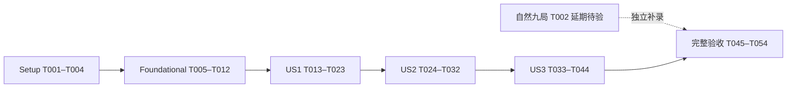

# Tasks: Sword Promotion Identity · 剑系转职可感知差异

**Input**: [plan.md](plan.md)、[spec.md](spec.md)、[research.md](research.md)、[data-model.md](data-model.md)、[combat-presentation](contracts/combat-presentation.md)、[promotion-preview](contracts/promotion-preview.md)、[validation](contracts/validation.md)、[quickstart.md](quickstart.md)。
**Governance**: [constitution](../../.specify/memory/constitution.md) v1.0.0、[AGENTS.md](../../AGENTS.md)。
**Generated**: 2026-10-21。原54项＋Phase 7追加8项，共62项；当前52项完成、10行开放（5类工作，含原任务与收敛承接项）。US1–US3源码／新Debug／实际Release自动、图形与九组合真实时钟通过，三组各60样本零差异；候选性能有效但p95=16.732ms超16.67ms目标。自然九局、五人理解／辨识与物理DEV待真人，002历史开放项保留。[当前收敛证据](../../docs/validation/sword-promotion-identity/convergence-20261021-v1/results.md)。
**分析修订 · 2026-10-21**：已落实I1／U1／A1：演示计时分层与独立真实检查、性能12窗新效果守卫、灰度12段独立判分；54项编号与全部未勾选状态保持，设计修订不代表实现或验收通过。

**实施预检 · 2026-10-21**：[T001环境](../../docs/validation/sword-promotion-identity/baseline/environment.md)与[验收矩阵](../../docs/validation/sword-promotion-identity/acceptance.md)已建立；源码与旧Release身份匹配，但仅找到3份工具负例manifest，[自然九局](../../docs/validation/sword-promotion-identity/baseline/natural-gate.md)仍缺失。未运行游戏回归或自然录制，未进入T003之后；用户同意越过未勾需求质量清单，原清单标记未改，未豁免T002。上方“分析修订”段为本次预检之前的历史状态。

**当前授权 · 2026-10-21**：用户已明确选择“将自然九局延期验收，先同步规格与任务依赖并继续实现；保留未验证状态”。此后依赖为T001→T003→T004→Foundation；T002独立待人工补录、保持未勾选。上方预检与历史生成说明保留原状态，已由本条替代其阻塞结论。

**Tests**: spec的SC-002／004／005明确要求逻辑、隔离、图形及比较验证；按宪法补齐可行自动化。先写对应断言并取得行为red，再实现至green；动态加载尚未创建的类型，解析／缺文件错误不能代替行为red。人工回答和性能结果不得代填。
**Organization**: Setup → Foundational → US1(P1) → US2(P2) → US3(P3) → Polish；每故事独立验证，产品集成按优先级推进。

## Format and path conventions

所有任务采用 `- [ ] Tnnn [P?] [USn?] 描述与文件路径`；路径相对仓库根目录，新路径表示待创建文件。`[P]`只用于依赖已满足、文件互不重叠的明确同批工作，不授权启动子代理。

- 固定引擎 `tools/godot-4.5/Godot_v4.5-stable_win64_console.exe`，版本 `4.5.stable.official.876b29033`；复用项目及原生suite，不安装依赖、不运行 `tools/create_m1_content.ps1`。
- 证据根为 `docs/validation/sword-promotion-identity/`；轮次使用全新 `<run-id>/`，构建使用全新 `builds/windows/sword-promotion-identity/<run-id>/`，保留旧构建、失败和原始输出。下文路径中的占位符必须在执行时替换为实际值。
- `STAGE`文档检查点统一指：更新 `docs/game-development-dashboard.html`、`docs/IMPLEMENTATION_OVERVIEW.md`、`README.md`、`docs/development.md`、本文件及对应实际证据；检查离线链接和图片alt。每个代码／美术逻辑批次结束即执行，不把同步拖到最终阶段。美术批次另同步 `docs/art-direction.md`、`assets/provenance.md`。
- 普通档、DEV沙盒和测试APPDATA隔离；schema v3、原音频六字段合同、其他职业及App单一DEV面板保持。新增比较开关仅属测试夹具，不新增玩家设置。

## Phase 1: Setup — 开工门槛与改前版本

**Purpose**: 先整理证据；不重建工程。T002已获用户授权延期验收、不阻塞代码／美术实施；先冻结未改动版本，任务生成不受阻。

- [X] T001 核对 `project.godot`、`export_presets.cfg`、`tools/run_validation.ps1`、`docs/validation/combat-pacing-audio/acceptance.md` 与当前源码；新建 `docs/validation/sword-promotion-identity/acceptance.md` 和 `docs/validation/sword-promotion-identity/baseline/environment.md`，逐项映射FR-001–012／SC-001–006、可用引擎／模板／设备、实际版本hash及缺口；记录数据模型ValidationSession的字段“run_id、engine、source_manifest、build_hash、fixture_hash、protocol、seed、hero／profession／party、starting_profile_hash、inputs、choices、environment、outcomes、failures、limitations”，初始均未验证。
- [ ] T002 按 `specs/002-combat-pacing-audio/quickstart.md` 自然协议，用 `tools/validate_pacing_audio.ps1 -Mode Record -FixtureMode Integrated -EvidenceDirectory docs/validation/combat-pacing-audio/<natural-run-id>` 取得当前未改动版本Aren／Lia／Milo×101／202／303完整真人九局，逐局新隔离正常档、永久1级／基础职业／无同伴／腐化0／满血／1×，核验首接受命中≤300tick、首杀≤600tick、首升级UI≤1800tick；在 `docs/validation/sword-promotion-identity/baseline/natural-gate.md` 链接原输入／选择／hash及全部失败。只可复用协议与当前hash均匹配的完整九局；缺失、死亡或超时均未满足，先在002范围处理并另版完整重录，不补挑成功局；用户已授权延期验收，不再阻止T003之后的实施，不追加五人／盲听等门槛（FR-012）。
- [X] T003 T001完成后（T002已授权延期验收），在 `builds/windows/sword-promotion-identity/<baseline-id>/source/` 冻结改前可运行源码及Resource／scene清单；从该根用 `tools/run_validation.ps1 -M4 -Export` 生成匹配Release／console及Debug构建，显式使用新BuildDirectory／EvidenceDirectory；将源码、引擎二进制、EXE、catalog及初始档／输入／选择清单写入 `docs/validation/sword-promotion-identity/baseline/manifest.json`，不将分支名当构建身份；复制前核验绝对路径、避开builds／证据的递归自复制，后续夹具覆盖只记录为外部测试层，不改冻结玩法源码。
- [X] T004 以 `tools/run_validation.ps1 -OnlySuites @('abilities','combat_feedback','combat_audio','integration_m2','persistence','replay') -EvidenceDirectory docs/validation/sword-promotion-identity/<baseline-check-id>` 执行旧行为基线，保留import／parse／content、强制debug_panel与参数拒绝；在 `docs/validation/sword-promotion-identity/baseline/results.md` 记录实际命令／退出码／失败／限制并执行STAGE同步；自动失败修复后重新核验当前hash与T002门槛，不能把旧九局自动套给新版本。

**Checkpoint**: 九局未验证明确保留且改前源码／构建可复现，自动回归无阻塞；设备不可用只开放对应图形／性能结论。

## Phase 2: Foundational — 共用比较与证据工具

**Purpose**: 在任何玩法表现变更前冻结投影、输入与夹具；不建立第二套战斗规则。

- [X] T005 在新 `tools/test_sword_identity.ps1` 编写Capture／Compare／Benchmark合同负例，先取得行为red：HP／计数／四RNG／选择篡改、缺seed、错误manifest、fixture变化、未知参数、已有输出目录、提前退出必须失败；仅允许V3明列版本身份／effects.color／新增sword_visual变化通过，原effects几何／expires及followups的due／damage等任一变化必须失败，不省略容器或未知字段（SC-005）。 增加性能窗口负例：总负载达标但任一分支／正治疗／候选渲染缺项、仅预热出现、全程满血、缺少任一600tick窗口均应拒绝。
- [X] T006 在新 `tools/sword_identity_contract.ps1` 实现并冻结 `sword-gameplay-v1` 投影／manifest验证，逐字采用 `specs/003-sword-promotion-identity/contracts/validation.md` V3白名单；原engine／simulation／seed／party／输入、effects数量顺序及direction／reach／angle／expires、followups原全部字段、damage_requests／activation_heals完整相等；每版source／build／catalog单独对自身manifest校验，另逐字段比较职业全部非VisualSet配置与非剑系VisualSet。保留原始记录，明确视觉字段移诊断而非丢弃，未知变化失败；通过T005相关正负例。
- [X] T007 在新 `tests/fixtures/sword_identity_session.gd` 复用 `tests/fixtures/pacing_session.gd`、`tests/fixtures/pacing_observer.gd` 和真实App／Run实现只读Capture夹具，记录原完整逐tick玩法状态及实际攻击／伤害／治疗时序；固定101／202／303、同英雄15级独立档／相同被动升级／输入选择，覆盖三剑系职业、Aren／Brann主角与同伴及弓／法分支；候选支持仅夹具表现开／关、预览访问／未访问，老版缺新字段写诊断适配，不补丁玩法、不伪造自然输入。
- [X] T008 在新 `tools/validate_sword_identity.ps1` 接线Capture和Compare：Capture显式ProjectDirectory、新EvidenceDirectory、固定4.5及隔离APPDATA；Compare显式BaselineDirectory／CandidateDirectory／新EvidenceDirectory，调用 `tools/sword_identity_contract.ps1`，核验同fixture／协议／初始档／输入选择／投影；输出原始状态、诊断、逐字段差异、命令与退出码。外部夹具在改前／改后可运行测试副本以相同字节覆盖，仅允许测试文件并分别记hash，原冻结源码不变；保持002同hash Replay守卫。
- [X] T009 在新 `tests/performance/sword_identity_benchmark.gd` 复用 `tests/performance/benchmark_capture.gd` 的真实负载及采样守卫，并在 `tools/validate_sword_identity.ps1` 接Benchmark：显式ProjectDirectory／匹配该根的ReleaseExecutable绝对路径／新EvidenceDirectory；相同剑系压力配置实际包含双刃／旋斩／长弧／治疗，100常规＋1首领、双同伴、≥30效果、≥100活动弹体、500宝石、腐化100，各30主动秒预热＋120主动秒采样；拒绝Debug、hash错配、时长／负载不足，不降低密度，完成T005剩余负例（SC-006）。 按 `specs/003-sword-promotion-identity/contracts/validation.md` V5冻结15级Aren剑圣／Brann深渊／Lia队伍、布局及每600tick把Brann置为maximum−10的Benchmark专用缺血输入；真实攻击／治疗路径不改、不手工emit提示。样本[1800,9000)分12窗，每窗双斩≥5／旋斩≥1／长弧≥5／第五次正治疗≥1，候选四类对应表现各≥1实际渲染帧；保存输入、逐窗计数及事实／帧关联，缺项capture_valid=false，基线仅核对真实玩法计数、不要求新增治疗提示，完成T005新增负例。
- [X] T010 将新夹具和后续测试所需内容在 `tests/script_manifest.gd` 登记，扩展 `tests/integration/test_replay.gd` 验证同版确定性及原002跨hash拒绝，沿 `tests/run_tests.gd` 现有replay／abilities／combat_feedback／integration_m2 suite接线，不把文件名当suite；确保 `tools/run_validation.ps1` 的OnlySuites仍强制debug_panel、未知suite和seed拒绝，新增文件均可parse。
- [X] T011 用 `tools/validate_sword_identity.ps1 -Mode Capture` 在T003冻结版本的测试副本采完整改前状态，保存 `docs/validation/sword-promotion-identity/<baseline-capture-id>/manifest.json`、原输入和投影／夹具hash；优先用Benchmark及真实图形采同版本基线。图形／性能环境缺失在 `docs/validation/sword-promotion-identity/baseline/results.md` 明列，允许从冻结旧版后补，不阻止US1；投影或夹具变更必须重采匹配前后数据并保留旧失败。
- [X] T012 运行 `tools/test_sword_identity.ps1` 与 `tools/run_validation.ps1 -OnlySuites @('replay','abilities','combat_feedback','combat_audio','integration_m2','persistence') -EvidenceDirectory docs/validation/sword-promotion-identity/<foundation-id>`，在 `docs/validation/sword-promotion-identity/foundation/results.md` 保存red／green、基线是否可补采及工具限制，执行STAGE同步；玩法源码尚未修改，受控输入不得计作自然门槛。

**Checkpoint**: 比较与负例可运行、固定投影／夹具／输入已有改前证据，原玩法与DEV回归通过。

## Phase 3: User Story 1 — 从动作辨认剑系打法 (P1) · MVP

**Goal**: 全部现有剑系主角／同伴能显示单剑、双刃、长刃与真实双斩／第五次旋斩，不改变转职页或治疗提示。
**Independent Test**: 同遭遇比较Aren／Brann三职业的idle／move／attack／hurt／death及第4／5／6次；三尺寸实机／灰度保留区别，几何、时点、计数及音频与改前相等。灰度12段与密集10张的人类辨识率留T048／T051最终验收。

### Tests first

- [X] T013 [P] [US1] 在 `tests/unit/test_content_contract.gd` 增VisualSet未知身份、默认空、三剑系身份错配及其他职业默认路径测试，验证职业而非英雄姓名驱动、Resource不存HP／计数且共享配置未写；先记录行为red（FR-001／002）。
- [X] T014 [P] [US1] 在 `tests/unit/test_profession_abilities.gd` 增Aren／Brann主角及同伴三身份、death > hurt > attack > move > idle、双弧0°／+20°同时可见、第五次360°及第六次普通、高攻速／Echo／来源死亡测试；断言stage4发动及下一tick stage1伤害、实际几何／计数不变，先记录行为red（FR-003／008／009）。

### Implementation

- [X] T015 [US1] 在 `scripts/data/visual_set.gd` 增sword_identity并在 `data/professions/swordsman.tres`、`data/professions/swordmaster.tres`、`data/professions/abyss_swordsman.tres` 赋值；落实数据模型原约束“StringName：空／single／dual／long，默认空；三剑系内嵌Resource赋后三值，其他职业空值走原路径”“保留既有字段与枚举兼容；颜色只辅助身份”“保留既有标识；不定义真实伤害时点”，在 `scripts/data/content_catalog.gd` 拒绝错配，禁止Resource持有HP／次数或由预览改写（依赖T013）。
- [X] T016 [US1] 新建纯绘制 `scripts/combat/sword_presentation.gd`，输入采用数据模型“identity、state、aim、active_tick、attack_age、moving、palette、is_companion、owner_marker”，遵守“state唯一且death > hurt > attack > move > idle”；复制位置方向、不持可写run／profile，原创single／dual／long在idle／move／attack均有不同几何；32px主体、整数绘制坐标／nearest、12tick姿态不改物理坐标，attack_age不控制AttackExecutor，保留主角浅金及同伴标记。
- [X] T017 [US1] 在 `scripts/combat/actor_presentation.gd` 归一状态后只对配置了剑系身份的职业调用 `scripts/combat/sword_presentation.gd`；同职业共享表现不按姓名分支，受伤／死亡覆盖主体但不取消既有伤害；其他职业沿旧绘制路径（依赖T014–T016）。
- [X] T018 [US1] 在 `scripts/combat/attack_executor.gd`、`scripts/combat/sword_branch_attacks.gd`、`scripts/core/run_manager.gd` 为原create_arc链附可选只读sword_visual；字段按模型落实“当前远征、来源actor、原实际发动次数；不新造计数”“真实职业及VisualSet身份”“base／primary／secondary／spin／echo”“原创建tick／tick＋10”“直接取实际hit参数；有限向量、非负有限reach、真实弧角”；嵌套集合逐层冻结，不持可写hit，Echo保留原due／发动身份且不传播heal_source，不增enqueue_hit／RNG／次数，非剑系默认空。
- [X] T019 [US1] 在 `scripts/combat/melee_arc.gd` 复用 `scripts/combat/sword_presentation.gd` 按实际origin／direction／reach／angle绘制同批双轨、完整360°旋斩及长弧，完整边界从born_tick可见、10主动tick到期；装饰不暗示范围外或延迟第二次伤害，友方效果避开敌方橙预警／红危险语义，不增全屏闪光／震动／时间缩放（依赖T018）。
- [X] T020 [US1] 在 `tests/integration/test_audio_facts.gd`、`tests/integration/test_replay.gd` 补剑系视觉元数据开／关对照，验证attack_committed仍恰好六字段、damage_accepted／hit_confirmed签名、原音频触发与其他职业一致；检查effects／followups新增字段仅命名sword_visual且几何不变（FR-008／011）。
- [X] T021 [US1] 新建 `tests/sword_identity_graphical_check.gd`，真实渲染两英雄三身份、双同伴／高攻速／hurt／death、普通／第五次／Echo、灰度及1280×720／1920×1080／1371×813；校验完整长弧／旋斩不裁切、HUD／主角标记／最近预警层级和暂停／重开清理，保存原图及灰度衍生图；在 `tools/run_validation.ps1` 的Graphical入口接入并更新 `tests/script_manifest.gd`，保留现有DEV图形检查，不把像素断言视作真人理解通过。
- [X] T022 [US1] 用 `tools/run_validation.ps1 -OnlySuites @('unit','abilities','combat_feedback','combat_audio','replay','integration_m2') -Graphical -EvidenceDirectory docs/validation/sword-promotion-identity/<us1-id>` 执行red到green及新源码图形窄测；用 `tools/validate_sword_identity.ps1` 对同输入剑系样本作Capture／Compare，原玩法差异须为0；在 `docs/validation/sword-promotion-identity/us1/results.md` 区分自动、真实图形与未验真人项，失败先修复。
- [X] T023 [US1] 依据 `docs/validation/sword-promotion-identity/us1/results.md` 执行STAGE同步，更新 `docs/art-direction.md`、`assets/provenance.md` 的原创程序绘制／尺度／状态与弧时序；图鉴只引用实际新截图，标US1证据范围、US2／US3仍未实现，不能提前声称SC-001／003通过。

**Checkpoint**: US1可单独试玩；实际攻击玩法、其他职业、音频及DEV无新增自动失败。缺真实图形则视觉仍未验证；人工辨识与性能独立开放。

## Phase 4: User Story 2 — 看懂实际续航收益 (P2)

**Goal**: 真实第五次治疗仅提示存活恢复者的实际增量，每次发动最多一次。
**Independent Test**: 无需US1外观或US3页面，检查4／5／6次、无目标／拒绝／零伤害、满血／近满血、满血后受伤、多目标／Echo／致死／来源死亡及同伴；0错误／重复，显示误差≤0.05。

### Tests first

- [X] T024 [P] [US2] 在 `tests/unit/test_profession_abilities.gd` 扩展治疗事实矩阵，检查第五次受伤、近满血裁剪、满血键消费后受伤不补发、第四／六次、无目标未发动、拒绝／零伤害、多目标／Echo、致死命中、来源死亡及同伴不随0.5伤害倍率折半；断言原治疗／计数／顺序与改前一致、事实只读且每发动最多一条，先取得行为red（FR-004／008、SC-002）。
- [X] T025 [P] [US2] 在 `tests/unit/test_combat_feedback.gd` 写反馈正负例：一位小数／临界舍入／小正数+0.0、旧generation／非正／非有限／重复及乱序事实、同源替换不累加、≤3记录／36主动tick、跟随同伴、死亡离场／终局／重开清理、暂停停龄／不补播，原48伤害记录预算不变；先取得行为red。

### Implementation

- [X] T026 [US2] 在 `scripts/combat/damage_service.gd` 原分支治疗块按heal前后HP差产生只读branch_heal_applied，字段采用“当前远征及实际结算主动tick”“存活的实际恢复者”“原发动与触发接受命中的请求ID”“float、有限且>0；heal后current减heal前current，不预取整”“值副本，用于诊断；显示仍按恢复者当前位置跟随”；标量／值Dictionary.make_read_only后发送，保持原heal签名与顺序、满血activation_heals的source:activation键仍消费，每个(generation, source_id, activation_id)最多一次，不驱动heal／攻击／音效。
- [X] T027 [US2] 在 `scripts/core/run_manager.gd`、`scripts/combat/combat_feedback.gd` 将只读branch_heal_applied接至唯一run反馈实例，绑定／退出／重开断开正确，按当前source_id跟随恢复者，拒绝旧generation或已死／离场来源；不修改现有attack_committed／damage_accepted／hit_confirmed或CombatAudio合同（依赖T026）。
- [X] T028 [US2] 在 `scripts/combat/combat_feedback.gd` 实现HealFeedbackRecord字段“generation、source_id、activation_id、actual_heal、born_tick、expires_tick”，落实“按source_id索引，最多3个队员记录、36主动tick；新同源成功替换旧记录，不累加量”“去重仅存每来源最后已接收activation_id，随run清空”；显示“+%.1f”，遵守“真实正值<0.05可显示+0.0及回流，不虚增为0.1；显示与原值误差≤0.05，测试仅容许浮点epsilon”，按主动tick停龄／清理，不占原48条伤害队列、不用墙钟或RNG。
- [X] T029 [US2] 在 `tests/sword_identity_graphical_check.gd` 加主角／同伴一次实际回流和近满血数值、满血／拒绝无成功提示、同源替换、暂停／升级／事件／结果／重开截图与生命周期断言；提示不遮身份／HUD／最近预警，死亡不伪造继续攻击，图形脚本不代填SC-003人工判断。
- [X] T030 [US2] 执行 `tools/run_validation.ps1 -OnlySuites @('abilities','combat_feedback','combat_audio','integration_m2','replay') -Graphical -EvidenceDirectory docs/validation/sword-promotion-identity/<us2-id>`，在 `docs/validation/sword-promotion-identity/us2/results.md` 保存矩阵逐例实际HP差、事实／显示次数及舍入误差、red／green和图形限制；阻塞失败先修复。
- [X] T031 [US2] 用 `tools/validate_sword_identity.ps1` 对T011同输入、两英雄主角／同伴及第4／5／6次样本Capture／Compare，原damage_requests、activation_heals、真实HP、发动计数和四RNG完全相等；只将新增表现事实／缓存放诊断，在 `docs/validation/sword-promotion-identity/us2/compare.md` 链接原始差异报告，不删玩法字段制造通过。
- [X] T032 [US2] 依据 `docs/validation/sword-promotion-identity/us2/results.md`、`docs/validation/sword-promotion-identity/us2/compare.md` 执行STAGE同步，更新 `docs/art-direction.md`、`assets/provenance.md` 的回流／数值语义；区分SC-002已验证案例与仍缺案例，US3仍未实现，保留002开放项。

**Checkpoint**: 数值事实可信、最多一次提示与原玩法相等；US2不依赖US1画质验收或US3页面，缺图形／真人不写通过。

## Phase 5: User Story 3 — 永久选择前看懂两条分支 (P3)

**Goal**: 现有转职页提供两个静音、独立的六秒示例，保留永久选择及保存保护。
**Independent Test**: 逻辑层注入时钟推进10循环／10开关；真实层在普通页与DEV页各观察10完整循环、开关10次，使用独立150／180秒预算；检测焦点／遮盖／调速／取消／确认／保存失败；真实状态零副作用，等级14／15×道具0／1资格不变，无需完整远征。

### Tests first

- [X] T033 [P] [US3] 新建 `tests/integration/test_promotion_preview.gd` 并在 `tests/run_tests.gd` 的integration_m2及 `tests/script_manifest.gd` 注册：以注入单调微秒时钟推进同一生产状态机，先测两Session、360tick时序／静音／快照只读、10循环／10开关真实profile字节revision／道具／奖励／队伍／HP／次数／四RNG与后续结果不变；初始失焦、回焦不补播、隐藏／退出／提交／父clear、普通DEV遮盖及DEV内ALWAYS、1×／2×／4×六秒不变，取得行为red；验证默认时钟绑定与注入接口，不等待真实60秒、不放宽原生55秒watchdog，真实播放另由T040／T042验证。
- [X] T034 [P] [US3] 在 `tests/unit/test_promotion.gd`、`tests/integration/test_persistence_v3.gd` 补等级14／15×道具0／1、错误基础职业、已永久转职、stale revision、重复确认、取消、保存失败／Retry回归；确认只消费1道具且保留XP／等级／被动，失败阻止继续且同pending重试不重复消费；先对新增预览相关保护取得行为red，不把既有通过写成新失败。

### Implementation

- [X] T035 [US3] 新建 `scripts/ui/promotion_preview.gd` 的独立Session，落实模型字段“仅显示身份及只读配置来源”“页面本地代号，不使用真实run generation”“本地60Hz；360tick循环，与Engine.time_scale无关”“0–5；30／90／150／210／270tick递增；下一tick示例结算，360重置”；sample_max_hp／sample_hp遵守“max来自分支基础值（当前250）；初始max−10；第五次取min(max, hp＋max×heal_fraction)，显示after−before（当前5.0）”；配置只读快照，共享实战绘制器及US2提示绘制，不调用真实RunManager／AttackExecutor／DamageService／CombatAudio／保存服务或RNG，每循环清理重置；now_usec遵守“只读单调微秒时钟Callable，生产默认Time.get_ticks_usec；仅逻辑夹具可注入，不暴露玩家开关，不用于真实播放验收”，注入仍走同一累积／冻结状态机。
- [X] T036 [US3] 在 `scripts/ui/promotion_preview.gd` 实现“独立生命周期；普通页host_occluded来自DEV overlay显隐，DEV内页不使用该遮盖源；不修改树暂停或run token”以及“剑圣最多3弧、深渊1弧；每示例最多1治疗记录”；初始化Window.has_focus并订阅焦点，单调时间剔除失焦且与Engine.time_scale解耦，可见获焦未遮盖才推进，回焦重置基准续原tick、不积压补播；确认／取消／退出／父clear停止并断开所有连接，重开新Session，不全树扫描／残留deferred任务（依赖T035）。
- [X] T037 [US3] 在 `scripts/ui/promotion.gd`、`scenes/ui/promotion.tscn` 仅替换剑系branch_previews两键为两个有界Control画布，保留confirmed(hero, branch, revision)／canceled、selected／submit／submitted／confirm_button及非剑系静态页；展示“演示 · 示例数值 · 节奏示意”、一句双斩／旋斩或长弧／第五次有效伤害恢复2%说明及永久选择限制；画布mouse_filter=IGNORE、不抢焦点，整数缩放容纳完整长弧，滚动panel≤640×360且确认／取消可达，低等级／无物也可观看（依赖T035／T036）。
- [X] T038 [US3] 在 `scripts/core/app_router.gd` 的show_promotion向普通页注入既有debug_panel.overlay，并在 `scripts/ui/promotion.gd` 初始化其visible／监听visibility_changed；保存阻塞拒绝close_panel时普通示例继续冻结，DEV内页不绑定该遮罩，Release无overlay默认未遮盖；ALWAYS宿主只推进自己的示例，不解冻run或释放pause token，退出断开连接，复用App单一DEV实例。
- [X] T039 [US3] 在 `tests/integration/test_debug_panel.gd` 增普通页被DEV遮盖／关闭被拒绝、DEV内页注入时钟推进10循环及离页清理回归；先ensure_session成功再对沙盒writer／payload／revision取预览基线，另从建沙盒前后及观看期间核对normal_writer字节不变；保留原克隆／receipt／writer切换、全部原控件、单例／暂停输入与Release全拒绝（FR-011）。
- [X] T040 [US3] 扩展 `tests/sword_identity_graphical_check.gd`，在普通／DEV宿主三尺寸检查两分支完整长弧／旋斩／一次治疗、标签／滚动／确认取消、初始失焦／遮盖／保存阻塞／提交／父清理；三尺寸布局与生命周期走快速图形检查。另新建 `tests/sword_preview_realtime_check.gd`，在1920×1080下每组合独立进程连续10真实循环、开关10次及焦点／清理检查；源码／新Debug各普通1×、DEV 1×／2×／4×，实际Release普通1×。使用生产单调时钟、设计周期6秒、实测每循环有效播放≤8秒，禁止注入／固定帧率加速；内部150墙钟秒截止，超时落部分循环数据。在 `tools/run_validation.ps1` 的Graphical接源码组合、显式外层180秒并确保超时保存stdout／stderr及已采数据，更新 `tests/script_manifest.gd`；保留其他55／60秒限制，导出接线由T047完成，不用截图替代人工理解。
- [X] T041 [US3] 执行 `tools/run_validation.ps1 -OnlySuites @('abilities','integration_m2','persistence','scene_smoke','combat_feedback','combat_audio','replay') -EvidenceDirectory docs/validation/sword-promotion-identity/<us3-logic-id>`，强制debug_panel随跑，在 `docs/validation/sword-promotion-identity/us3/results.md` 保存red／green及注入时钟10循环／开关、资格、保存失败／Retry、真实状态零变化的逐例结果；自动失败先修复，逻辑时钟结果不计真实播放验收。
- [X] T042 [US3] 执行 `tools/run_validation.ps1 -OnlySuites @('integration_m2','scene_smoke') -Graphical -EvidenceDirectory docs/validation/sword-promotion-identity/<us3-graphics-id>` 检查三尺寸快速图形，并执行T040源码1920×1080各host／speed独立真实播放组合；核对普通无run与DEV暂停树焦点／遮盖／调速，记录逐循环有效播放时间、开关计数、清理和输入结果到 `docs/validation/sword-promotion-identity/us3/graphical.md`；每组合内部150秒／外层180秒，未满10循环、超时或无显示／焦点能力记失败／未验证，不改用注入时钟凑通过。
- [X] T043 [US3] 用 `tools/validate_sword_identity.ps1` Capture／Compare比较候选预览访问／未访问及表现开／关，核对profile／revision／真实HP／队伍／远征计数／四RNG和后续升级／事件结果零变化，另与改前同输入玩法比较；将完整报告链接写入 `docs/validation/sword-promotion-identity/us3/compare.md`，保留非剑系静态预览与原转职保存语义。
- [X] T044 [US3] 依据 `docs/validation/sword-promotion-identity/us3/results.md`、`docs/validation/sword-promotion-identity/us3/graphical.md` 执行STAGE同步，更新 `docs/art-direction.md`、`assets/provenance.md` 的示例标识／节奏／取值来源；只写实测SC-004边界，不关闭真人理解／物理DEV／完整性能或002未完成验收。

**Checkpoint**: US3可以从现有页面独立验证，不需要完成远征；视觉复用US1，治疗示例复用US2绘制。保存保护与DEV回归通过，人工结论分开记账。

## Phase 6: Polish & Cross-Cutting Concerns — 完整验收

**Purpose**: 保护全部玩法、实际导出与证据可信度；未执行的人机／环境任务保持未勾选。

- [X] T045 用 `tools/validate_sword_identity.ps1` 在匹配改前／改后项目根Capture并Compare完整101／202／303矩阵：同英雄15级基础／两分支、两英雄主角／同伴、既有弓／法及其分支、候选表现开／关和访问预览／未访问；检查逐tick位置／HP／冷却／计数、XP／升级／波次／事件／腐化、四RNG、实际攻击伤害治疗及终结／保存逐字段相等，在 `docs/validation/sword-promotion-identity/final/compare.md` 链接manifest与原始输出（SC-005）。
- [X] T046 用 `tools/test_sword_identity.ps1` 重跑全部投影／manifest／输入／参数拒绝正负例，确保同effects／followups内视觉变更可通过而任一几何／expires／due／damage变更必失败，未知字段不被剔除、原002跨hash拒绝仍成立；将实际结果写入 `docs/validation/sword-promotion-identity/final/tool-contract.md`，若夹具或投影已变则重采T011／T045匹配数据。
- [X] T047 在 `tools/run_validation.ps1` 接好新剑系快速图形及 `tests/sword_preview_realtime_check.gd` 的源码、新Debug和实际Release探针；导出采用外部自包含harness，不依赖PCK内tests，新Debug普通1×／DEV 1×／2×／4×及Release普通1×各独立运行、内部150秒／外层180秒，超时保留原始日志并失败；更新 `tests/script_manifest.gd`，保留原M1–M4／DEV／音频／保存检查；执行 `./tools/run_validation.ps1 -M4 -Graphical -Export -BuildDirectory builds/windows/sword-promotion-identity/<final-build-id> -EvidenceDirectory docs/validation/sword-promotion-identity/<final-regression-id>`，在 `docs/validation/sword-promotion-identity/final/regression.md` 保存实际导出hash／日志／退出码，真实Release全部调试动作仍拒绝，失败／阻塞不记pass。
- [X] T048 从 `tests/sword_identity_graphical_check.gd` 的真实三尺寸战斗取基础／双刃／长刃普通与第五次片段，另采含双同伴、腐化100和首领预警的10张密集截图；在 `docs/validation/sword-promotion-identity/human/stimuli.json` 固定原图／灰度衍生图hash、随机题序及最近预警答案（同距均接受），原图保留、SC-003灰度题材固定同英雄15级／无同伴／同seed，三尺寸×两分支×普通／第五次共12段，各1秒，统一移除职业名、数值等文字答案线索，保留实际轮廓／动作／剑弧；另存SC-001原始无名片段及12段灰度版的处理规则、分支／攻击类型答案、hash和每人随机题序，测试界面隐藏答案；标受控来源，不生成假截图或把存在图片视为SC-001／003通过。
- [ ] T049 用 `tools/validate_sword_identity.ps1 -Mode Benchmark` 在同机匹配源码／Release分别采改前／后剑系压力、相同seed101／输入／fixture／画面／音频，各30主动秒预热＋120主动秒；保留逐帧CSV、p50／p95／p99／max、100常规＋1首领／双同伴／≥30效果／≥100弹体／500宝石／腐化100实际负载，以及1920×1080／VSync off／无调试器、CPU／GPU／driver／音频播放／焦点／电源／后台观察范围到 `docs/validation/sword-promotion-identity/performance/results.md`；改后p95≤16.67ms且p99≤25ms才满足本机目标，环境不足明确未验证，不关闭Q1参考机或002历史项目（SC-006）。 依V5复核12个600tick窗口及逐帧总负载；每窗双斩≥5／旋斩≥1／长弧≥5／合法正治疗≥1，候选四类表现各至少1个真实渲染帧，任何缺项／仅预热发生即capture_valid=false；前后冻结相同缺血输入并独立记录，不拿满血或占位弧样本作性能通过。
- [ ] T050 邀请5名未接触改版的真实玩家，按 `specs/003-sword-promotion-identity/spec.md` SC-001用同英雄15级／无同伴／同seed独立分支档先看预览、随机看无名普通／第五次片段、各操作两分支3主动分钟，试玩不用DEV；在 `docs/validation/sword-promotion-identity/human/understanding.md` 保存P01–P05原话、偏好及玩法理由、死亡／疲劳／重试意愿，至少4人正确说出两分支普通＋第五次作用才通过；人数不足或无原话保持待人工验收。
- [ ] T051 对T050同组真实玩家按 `docs/validation/sword-promotion-identity/human/stimuli.json` 每图1秒展示随机10张密集截图，在 `docs/validation/sword-promotion-identity/human/readability.md` 保存每人逐图主角／最近敌方预警回答及全部失败；密集截图至少4人各在≥8/10张同时答对。另按SC-003进行12段灰度分支识别，每段1秒一次、首答计分／不确定计错、不提示或重播补答，至少4人各≥10/12且普通／第五次各≥5/6；在同一报告逐条保存12段原答和分组得分，灰度与密集截图分别达标才通过SC-003，不能用AI回答或受控图形断言替代。
- [ ] T052 按 `docs/developer-debug-panel.md` 做源码及新Debug导出的物理鼠标／F9／Fn／缩放／转场／暂停／全控件烟测，将结果写入 `docs/validation/sword-promotion-identity/human/debug-smoke.md`，核对DEV角落按钮、App单例、F9、隔离保存和Release拒绝；若需独立导出诊断，在正常回归后用 `tools/run_debug_validation.ps1 -SkipRegression -DummyAudio -BuildDirectory builds/windows/sword-promotion-identity/<debug-probe-id> -EvidenceDirectory docs/validation/sword-promotion-identity/<debug-probe-id>`，Dummy仅诊断，未执行物理检查不记通过。
- [X] T053 将 `specs/003-sword-promotion-identity/quickstart.md` 中拟新增入口替换为已实现且实际核对的Capture／Compare／Benchmark命令、参数与新路径，复核启动／隔离／失败保留说明；执行STAGE同步并更新 `docs/art-direction.md`、`assets/provenance.md`、`docs/validation/sword-promotion-identity/final/docs-check.md`，检查离线相对资源、锚点、图片alt、概览≤600字主摘要及README双入口，只引用真实截图和本轮证据。 核对指南包含逻辑时钟／独立真实播放150／180秒预算、性能12窗计数与灰度12段判分，新增脚本和模式仅在实现后写为可执行命令。
- [X] T054 在 `docs/validation/sword-promotion-identity/acceptance.md` 及 `docs/validation/sword-promotion-identity/final/results.md` 逐项汇总FR-001–012／SC-001–006、实际命令／版本／种子／退出码／失败／限制，按已实现并验证／已实现未验证／部分完成／未实现／待人工验收记账，更新 `specs/003-sword-promotion-identity/tasks.md` 真实完成项；未做人工／性能／导出任务保留未勾选，明确002自然九对／盲听／其他历史门禁不因003交付自动关闭。

**Checkpoint**: 自动／真实图形／自然操作／人工理解／性能分别有真实结论，缺口显式开放；代码完成不等于全部验收完成。

## Dependencies & Execution Order

- Phase 1：T001可先整理文档；T002经用户明确授权延期验收，不再阻止代码／美术／比较工具实施。T003先冻结，T004记录旧行为；若基线修复改版，重新核验九局与冻结身份。
- Phase 2：T005→T006→T008；T007是T008 Capture的前置；T009补Benchmark，T010接注册，T011冻结同夹具基线，T012通过后进入故事。图形／性能环境不足不额外阻止US1，但对应SC保持未验证，改前证据只能由冻结旧版补采。
- US1：T013／T014同批→T015→T016→T017；T018→T019；T020／T021完成后T022→T023。T015与T018共涉及职业身份约定，不按不同文件就擅自并行。
- US2：逻辑上只依赖Foundation和原DamageService，不依赖US1画面验收；推荐US1后集成，避免共同修改run_manager／图形夹具冲突。T024／T025同批→T026→T027→T028→T029→T030→T031→T032。
- US3：T033／T034同批；T035依赖US1共享绘制器和US2反馈绘制，但US3测试可用只读夹具独立运行；T035→T036→T037→T038→T039→T040→T041→T042→T043→T044，不要求完成远征或SC-001真人验收才测试页面。
- Final：T045／T046先证明完整玩法与比较可靠；T047生成实际导出图形，T048采题材；T050在题材及预览可用后，T051必须沿用T050同组。T049需T009固定夹具与匹配前后Release，可与人工预约分别推进；T052需要T047新Debug。T053→T054汇总，任何自动阻塞失败先修复，不用时间不足跳过必需检查。
- 所有阶段执行STAGE检查点；人工／设备不可用只阻塞该项完成，不能勾选未执行任务或将旧证据升格。

## Parallel Examples per Story

下列仅为任务调度说明，不是实际派发代理；每组开始前必须满足上述共同前置。

| Story | 同批可并行任务 | 不同文件及边界 |
| --- | --- | --- |
| US1 | T013 + T014 | `tests/unit/test_content_contract.gd` 与 `tests/unit/test_profession_abilities.gd`；Foundation后写独立red，均不改共享runner |
| US2 | T024 + T025 | `tests/unit/test_profession_abilities.gd` 与 `tests/unit/test_combat_feedback.gd`；前故事已收口，分别覆盖结算和提示 |
| US3 | T033 + T034 | `tests/integration/test_promotion_preview.gd`／runner／manifest 与 `tests/unit/test_promotion.gd`／`tests/integration/test_persistence_v3.gd`；分别隔离页面与资格／保存 |

共享 `scripts/core/run_manager.gd`、`tests/sword_identity_graphical_check.gd`、文档与manifest的任务串行合并；不把整个故事标为互不依赖。

## Requirement and Contract Coverage

| 需求／合同 | 主要任务 | 验证出口 |
| --- | --- | --- |
| FR-001／002，SwordVisualIdentity／SwordPose，C4 | T013–T017 | T021／T022、T048／T050／T051 |
| FR-003，SwordArcVisual，C1 | T014／T018／T019 | T020–T022、T045–T048 |
| FR-004，BranchHealApplied／HealFeedbackRecord，C2／C3，SC-002 | T024–T028 | T029–T031、T045 |
| FR-005／006，PromotionPreviewSession，P1–P5，SC-004 | T033／T035–T040 | T041–T043、T047 |
| FR-007，P3，原保存合同 | T034／T037–T039 | T041／T043／T047 |
| FR-008／009，C1–C3，P3／P4，SC-005 | T005–T012／T018／T026–T028／T036–T038 | T022／T030／T031／T041／T043／T045–T047 |
| FR-010，C4，SC-003 | T016／T019／T021／T029／T040 | T048／T051 |
| FR-011，原DEV与音频合同 | T020／T038／T039 | 每次run_validation强制debug_panel、T047／T052 |
| FR-012，ValidationSession，V0／V1／V6 | T001–T004／所有STAGE | T002、T023／T032／T044／T053／T054 |
| SC-001，V4 | T048／T050 | 五人原话与至少4人正确解释；不足保持待人工验收 |
| SC-006，V5 | T003／T009／T011／T049 | 匹配Release／同机同负载CSV及环境限制 |

## Implementation Strategy

### MVP First — US1

1. 先完成T001／T003／T004冻结改前版本与回归，T002延期待验，再完成比较基础（T005–T012）。
2. 仅实施US1（T013–T023）：三剑系轮廓与真实双斩／第五次旋斩；保持现有治疗提示和转职页。
3. 完成US1窄测、图形、同输入玩法比较与STAGE同步后，提供当前源码试玩。MVP仅说明US1可验证，不声称已满足五人理解、密集辨识或性能验收。

### Incremental Delivery

US1 → US2实际恢复反馈 → US3独立转职示例 → 完整回归／导出／跨版比较 → 真人／性能分别记账。各故事的独立测试无需通过其他故事的人体验收；US3复用已有绘制模块，不复制完整战斗模拟。自然九局经2026-10-21用户授权延期验收，可继续实施；人工缺口仍保留，不能代填通过。

## Generation Validation

生成时仅检查设计、现有源码／测试路径、任务格式与文档引用；未运行上述游戏命令、导出、自然九局、人工或性能测试。扩展钩子执行前后均检查 `.specify/extensions.yml`，结果见 [任务生成记录](../../docs/validation/sword-promotion-identity/task-generation-20261021.md)。需求质量清单仍由审阅者独立维护，本次不修改其勾选状态。

## 实施检查点 · Setup — 2026-10-21

[T003／T004实际结果](../../docs/validation/sword-promotion-identity/baseline/results.md)：冻结源码、16组9,232断言与新Debug／Release导出通过；当前窄测7组879通过。T002延期且未验证，受控输入待T007／T011冻结，不据空清单声称比较通过。

## 实施检查点 · Foundation — 2026-10-21

[实际结果](../../docs/validation/sword-promotion-identity/foundation/results.md)：51个比较／负例、54个基线受控样本及自比较0差异，7组891断言通过。T009的Release样本因守卫失败无效，诊断中；不标性能通过。T012最终阶段检查在修复后收口。

### Foundation收口 — 2026-10-21

[T009／T012](../../docs/validation/sword-promotion-identity/foundation/results.md)：52工具检查0失败，原7组891断言通过，改前图形与修正布局Release压力捕获有效；进入US1测试先行。自然九局仍延期，改后性能／人工辨识未验证。

## 实施检查点 · US1 — 2026-10-21

[实际结果](../../docs/validation/sword-promotion-identity/us1/results.md)：逻辑／真实受控图形／54组跨版玩法0差异通过；灰度人工识别率与改后性能未验。基线已按固定完整初始档重采v4，夹具hash改变后不得使用旧v1–v3比较。US2／US3未实现。

## 实施检查点 · US2 — 2026-10-21

[实际结果](../../docs/validation/sword-promotion-identity/us2/results.md)：原治疗点只读实际增量、独立有界反馈、6组1096断言、扩展640图形及54组跨版0差异通过；US3未实施，人工／改后性能未验证。

## 实施检查点 · US3逻辑／布局 — 2026-10-21

[结果](../../docs/validation/sword-promotion-identity/us3/results.md)：8组1674断言及676快速图形通过。生产单调时钟十轮、最终对照／导出／性能仍在执行；不以注入时钟替代真实播放。

## 最终自动收口 · 2026-10-21

[结果](../../docs/validation/sword-promotion-identity/final/results.md)：16组9917原生断言、源码M1–M4／DEV／音频／剑系图形、源码＋新Debug八个生产时钟组合、三组各54样本零差异、52＋26工具检查通过；18彩色／12灰度／10密集题材冻结，3344捕获断言，0真人回答。完整导出命令在Windows4551处失败；同版复测／另一新目录Release仍受阻，未改系统安全策略。实际Release探针／图形／真实播放与候选性能未验，T047／T049不勾选；T002／T050／T051／T052待人工。48／54任务完成，不能声称整切片验收通过。

## Phase 7: Convergence

**核对日期**：2026-10-21。结果 `tasks_appended`；按当前源码／Resource／scene及已有原始证据核对12项FR、6项SC、15个验收场景、9个边界场景、8项计划决策、8条宪法原则及全部54项原任务。8个发现均为partial（HIGH 5、MEDIUM 3）；missing／contradicts／unrequested各0，未发现可确认的宪法MUST违规。本轮仅运行前置检查、只读源码／证据／hash及文档路径检查，未重新运行Godot、导出、自然操作、人工或性能测试。

**范围与依赖**：F1／F8为新增确认的覆盖与维护缺口；其余六项承接T002／T047／T049／T050／T051／T052的未完成工作，不要求重复执行同一验收。原阶段、编号、勾选及历史证据保持原字节；后续implement依据真实结果分别更新关联任务。T056→T057，T058→T059；T060依赖可用新Debug，T061继续独立延期，任何人工／环境缺失不代填。后续实现／验证批次沿用STAGE文档同步及原DEV保护；本次不改spec／plan或其他文档。

- [X] T055 HIGH [F1] 补齐 `tests/fixtures/sword_identity_session.gd`、`tools/validate_sword_identity.ps1` 及比较合同的受控流程覆盖：当前 `final-capture-enabled-20261021-v1` 全54样本均为360tick、临时等级1、trace.offers／decisions／events为空、phase始终active且profile未结算，不能据空字段相等验证后续随机选择与终局保存；保留原54×360tick矩阵与V3白名单，增加通过现有真实服务路径发生升级出牌／确认、事件生成／选择、终局汇总／一次保存结算的匹配改前后场景，固定101／202／303、初始档／输入／选择，比较候选表现开／关及访问／未访问预览；为每个必经行为设非空覆盖守卫，缺失、提前退出或结果篡改必须失败。若夹具／协议变化则重采匹配前后证据并保留旧记录，在 `docs/validation/sword-promotion-identity/final/compare.md` 与验收矩阵区分已覆盖和未覆盖范围，执行STAGE同步 per SC-005, FR-006／008, US3/AC3, plan: 比较决策, T007／T043／T045 (partial)
- [X] T056 HIGH [F2] 承接T047，补齐实际新Release的全部调试动作拒绝探针、剑系快速图形与普通1×生产时钟十轮／十开关：`docs/validation/sword-promotion-identity/final/regression.md` 记录两版CreateProcess4551且Release探针0断言，源码／Debug通过不能替代；在允许该实际构建正常启动的环境，以新构建／证据目录运行原 `tools/run_validation.ps1 -M4 -Graphical -Export` 门禁并保存源码／EXE／fixture hash、命令、退出码及失败。不得通过修改系统安全策略或伪造passed manifest绕过阻塞；仍不可启动则保留未完成，真实通过后更新回归／矩阵及STAGE文档 per FR-011, SC-004／005, plan: 验证执行, T047 (partial)
- [ ] T057 HIGH [F3] 承接T049，在T056取得可启动且实际Release拒绝探针通过的匹配构建后，使用 `tools/validate_sword_identity.ps1 -Mode Benchmark` 补候选30主动秒预热＋120主动秒采样，并核对与改前基线同机、同fixture／seed101／输入／布局／音频／负载；`docs/validation/sword-promotion-identity/performance/results.md` 当前候选0采样帧。保存逐帧CSV、12个600tick窗口的真实双斩／旋斩／长弧／正治疗及候选四类渲染关联、完整负载与环境限制；仅有效样本且p95≤16.67ms／p99≤25ms才判本机达标，若夹具或环境不同则重采匹配基线，保留旧失败及历史验收开放状态并执行STAGE同步 per SC-006, plan: 性能与验收判定, T009／T049 (partial)
- [ ] T058 HIGH [F4] 承接T050，按同英雄永久15级／无同伴／同种子独立分支档，取得5名未接触改版真实玩家先看预览、随机无名普通／第五次片段、各分支3主动分钟的实际记录；`docs/validation/sword-promotion-identity/human/understanding.md` 当前0份原话。保留P01–P05解释、偏好与玩法理由、死亡／疲劳／重试意愿及全部失败，至少4人正确解释两分支普通与第五次作用才关闭SC-001；人数或现场条件不足继续待人工验收，不由代理代答或自动邀请，按真实结果同步验收及STAGE文档 per SC-001, US1/AC1–4, US3/AC1–2, T050 (partial)
- [ ] T059 HIGH [F5] 承接T051，对T058同组五名玩家使用已冻结 `docs/validation/sword-promotion-identity/human/stimuli.json` 与原始题材，补12段灰度分支和10张密集预警的一秒首答；`human/readability.md` 当前0份真人回答。灰度至少4人各≥10/12且普通／第五次各≥5/6，密集至少4人各≥8/10同时指出主角与最近敌方预警，两项独立达标；保留全部原答、题序、hash、无效展示与失败，不提示／重播补答，不以图形断言替代；不足继续待人工验收，实测不达标时只修复本切片可读性并重新验证，更新报告／矩阵及STAGE文档 per FR-010, SC-003, US1/AC1／5, T048／T051 (partial)
- [ ] T060 MEDIUM [F6] 承接T052，按 `docs/developer-debug-panel.md` 完成当前源码及匹配新Debug导出的真实物理鼠标／F9／Fn／缩放／全界面转场／暂停与原控件烟测，将实际输入、环境、结果和失败写入 `docs/validation/sword-promotion-identity/human/debug-smoke.md`；现有自动DEV断言不替代该检查。核对可见DEV、App单例、隔离保存与既有操作，Release拒绝引用T056真实结果；无人操作则继续待人工验收，完成后同步矩阵及STAGE文档 per FR-011, SC-005, T052 (partial)
- [ ] T061 MEDIUM [F7] 承接已获延期授权的T002，在冻结未改动基线按002的Record／Integrated自然协议补Aren／Lia／Milo×101／202／303完整真人九局，逐局隔离永久1级基础职业／无同伴／腐化0／满血／1×，保存输入／选择／版本hash并核验首有效命中≤300tick、首杀≤600tick、首升级UI≤1800tick；`docs/validation/sword-promotion-identity/baseline/natural-gate.md` 当前仍缺完整记录。缺失／死亡／超时保留失败，不补挑成功局；需修复则按002原范围另版完整重录。继续作为独立待人工项，不恢复为本切片实施前置，不关闭002其他开放项，取得真实记录后更新自然门槛／矩阵及STAGE文档 per FR-012, plan: 自然九局延期验收, T002 (partial)
- [X] T062 MEDIUM [F8] 修复 `tools/check_003_docs.py:72` 对任务总数恰好54的硬编码，使合法追加Convergence阶段后仍检查任务格式、ID唯一及有序追加，并保留原任务不可重编号／覆盖的约束；当前本阶段追加后会被旧检查错误拒绝。补有效追加及重复／非法编号的针对性正负例，保留离线路径、图片alt、题材hash与概览长度检查，实际重跑文档检查后将新任务数／开放状态与未完成验收如实写入 `docs/validation/sword-promotion-identity/final/docs-check.md`／JSON和STAGE文档，不改写旧验证证据或提前勾选其他任务 per FR-012, plan: 文档与状态, T053／T054 (partial)

### Phase 7实施检查点 · 2026-10-21

[实际结果](../../docs/validation/sword-promotion-identity/convergence-20261021-v1/results.md)：T055／T056／T062及原T047完成；T049／T057样本有效但帧时预算失败，未勾选。三组各60样本零差异、12流程守卫测试／54工具检查／26投影检查／10文档测试通过，完整M4图形导出退出0、16组9917原生断言、九组合生产时钟通过。后续实现按技能在非并行失败处停止；仅同步文档，不改变已有玩法或降低负载。人工四类仍待真人。
